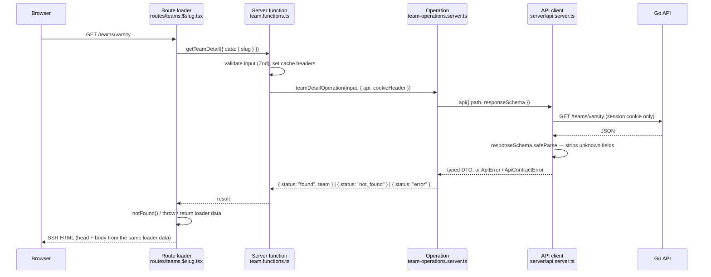
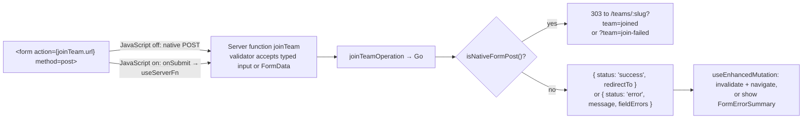

# 26 — Frontend onboarding

A guide for a developer joining the web frontend (`apps/web`). It explains how
the pieces fit and where to start. It does not own any rule: where a fact has
an owner (see [README — Sources of truth](./README.md#sources-of-truth)), this
page links to it rather than restating it.

Read [`CLAUDE.md`](../CLAUDE.md) and [`AGENTS.md`](../AGENTS.md) first. They
cover install, the check commands for each area, branch and pull request rules,
commenting, and test value. Everything below assumes them.

## The short version

- The browser never talks to the Go API. It talks to the TanStack Start server
  in `apps/web`, which is a Backend for Frontend (BFF). The BFF calls Go over a
  private network, validates every response with Zod, and hands the page a
  small display object.
- Go owns every rule: who may do what, what exists, what is valid. The web app
  decides only what to _show_, from what Go tells it.
- Pages are server-rendered from route loaders. Forms are plain HTML forms that
  work without JavaScript; JavaScript only improves them.
- Code is organized by feature slice under `src/features/<slice>/`, and every
  slice has the same five kinds of file.

## Where things live

```text
apps/web/src/
  routes/            one file per URL (TanStack Router file routes)
  features/<slice>/  everything for one product area
    contracts.ts              Zod schemas, DTO types, input validators
    <name>.functions.ts       server functions (the RPC entry points)
    <name>-operations.server.ts  calls to Go; server-only
    presentation.ts           page head metadata, notices, labels
    *.tsx, *.css              slice components and the slice stylesheet
  components/        shared UI used by more than one slice
  server/            the request boundary: API client, cookies, viewer, env
  start.ts           request middleware: CSP and security headers, CSRF
  router.tsx         router and default pending/error/not-found views
  styles.css         tokens, base styles, and the cascade layer order
  components.css     styles for shared components
apps/web/tests/      unit tests (Vitest), one file per area
```

The teams slice is a good reference because it is small and complete:
`features/team-slice/` plus `routes/teams.*.tsx`. The examples below use it.

## How data flows

### Reading: a page load



Step by step, with the files involved:

1. **The route** (`routes/teams.$slug.tsx`) declares `validateSearch`,
   `loader`, `headers`, `head`, the pending/error/not-found components, and the
   page component. The loader calls one or more server functions, usually in
   `Promise.all`.
2. **The server function** (`team.functions.ts`) is a `createServerFn` with a
   Zod `validator`. During server rendering it runs in-process; on a client
   navigation the router calls it over RPC. Either way the handler runs on the
   server. It picks the request context (`goBFFForCurrentRequest()` for public
   reads, `currentSessionRequest()` when the viewer matters), sets the
   response cache headers, and delegates to an operation.
3. **The operation** (`team-operations.server.ts`) is plain async TypeScript
   that takes its dependencies as arguments (`api`, `cookieHeader`,
   `reportError`). It calls the API client with a path and a response schema,
   shapes the result for the page, and turns failures into a discriminated
   result such as `{ status: "not_found" }` instead of throwing. Because it has
   no framework imports, tests call it directly with a stub `fetch`.
4. **The API client** (`server/api.server.ts`, built by `server/bff.server.ts`)
   adds trusted visitor headers, forwards only the session cookie, parses the
   JSON, and runs the response schema. A non-2xx answer throws `ApiError` with
   Go's error code. A response that fails its schema throws `ApiContractError`
   and is reported to Sentry with its path and issues, never its body.
5. **Back in the route**, the loader maps the result: `not_found` becomes
   `throw notFound()` (a real HTTP 404), an outage becomes `throw new Error()`
   (the route's error view), and success becomes loader data. The `head`
   function builds titles and Open Graph tags from that same loader data; it
   never fetches again.

A list that fails to load does not have to take the page down. Browse
operations return an `unavailable` flag (for example `teamsUnavailable`) and
the page renders `ListUnavailable` in place of the list.

### Who is looking: the viewer

The root route (`routes/__root.tsx`) calls `getPublicRuntimeConfig` in
`beforeLoad` on every navigation. If the request has a session cookie, that
makes one `/me` call and puts a minimal viewer (id, name, home school) in
router context; without a cookie it makes no upstream call. Components read it
with `useViewer()` from `components/viewer.tsx`.

The viewer in context is for the header and small presentational choices. A
page that needs the full profile or the viewer's role on a record gets it from
its own operation (`optionalViewerProfile`, or a `viewer_role` field in the
API's response). The request boundary shares one `/me` read per request, so
this costs nothing extra.

If Go answers `401 authentication_required` to a request that carried a
session, the BFF deletes the cookie and sets `x-cgn-session-ended`; the browser
middleware in `start.ts` sees it and the root route re-runs its loaders. See
[06 — Request and cache boundaries](./06-architecture.md#request-and-cache-boundaries).

### Writing: a form submission

Every mutation is one `<form method="post">` that works two ways.



The pieces, from `routes/teams.$slug.tsx` (`TeamJoinForm`) and
`team.functions.ts` (`joinTeam`):

- The form's `action` is the server function's `.url`, its fields are real
  named inputs (hidden inputs for ids and slugs), and it has native
  constraints (`required`, `minLength`, `maxLength`).
- `onSubmit` calls `event.preventDefault()`, reads the `FormData` with
  `formString`, and passes typed data to `mutation.execute(() =>
  runJoinTeam({ data }))`. `useEnhancedMutation` marks the form busy, then
  either invalidates and navigates to `redirectTo` or renders
  `FormErrorSummary` and focuses it.
- The server function is declared with `strict: { input: false }` and a
  validator that accepts `Input | FormData` (`validateJoinTeamServerInput` in
  `contracts.ts`). It always calls `setPrivateNoStoreResponse()`.
- For a native post it ends in a `303` redirect to the page with a notice key
  in the query string (`?team=joined`). The page lists its allowed notices in
  `presentation.ts` (`teamDetailNotices`), validates the key in
  `validateSearch` with `pageNoticeKey`, and renders `PageNoticeView`. An
  unknown key renders nothing, so the query string cannot inject a message.
- Create forms carry an `idempotency_key` hidden input
  (`components/idempotency-key.ts`) generated in the loader, so a double submit
  does not create two records. Which endpoints require it is in
  [04 — Cross-cutting API requirements](./04-api.md#cross-cutting-api-requirements).
- Destructive actions go through `ConfirmDialog`, which wraps the same form.

To check a form works without JavaScript, turn JavaScript off in the browser
and submit it, including an invalid submission.

## Page architecture

A route file owns a URL's status, cache headers, metadata, and states
together, so a missing record can never render as a soft 404 page with a 200.

| Route option                          | What it does here                                                                                                                                           |
| ------------------------------------- | ----------------------------------------------------------------------------------------------------------------------------------------------------------- |
| `validateSearch`                      | Parses the query string with a function from `contracts.ts`. Unknown or malformed values are dropped.                                                       |
| `loaderDeps`                          | Declares which search values the loader depends on, so the loader reruns when they change.                                                                  |
| `loader`                              | Calls server functions; maps results to `notFound()`, `redirect()`, a thrown error, or data. Adds `publicOrigin` from context for metadata.                 |
| `staleTime: 0`                        | Pages with viewer-dependent data always reload; router caching is not treated as a shared cache.                                                            |
| `headers`                             | `private, no-store` when the request had a session (or always, for signed-in pages); otherwise `public, max-age=0, must-revalidate`. Always `vary: Cookie`. |
| `head`                                | Title, description, Open Graph, `noindex`, and the slice stylesheet link, built by a `presentation.ts` helper on top of `components/public-page-head.ts`.   |
| `pendingComponent` / `errorComponent` | `RoutePending` and `RouteErrorView` from `components/route-boundaries.tsx`. Error views never show upstream messages.                                       |
| `notFoundComponent`                   | `RecordNotFound` with the entity kind.                                                                                                                      |
| `component`                           | Reads `Route.useLoaderData()` and `Route.useSearch()`. One `<main>` and one `<h1>`.                                                                         |

File naming follows TanStack Router: `teams.tsx` is a layout with an
`<Outlet />`, `teams.index.tsx` is `/teams`, `teams.$slug.tsx` is
`/teams/:slug`, and `teams.$slug_.people.tsx` (trailing underscore) is
`/teams/:slug/people` rendered without nesting inside the detail page.
`routeTree.gen.ts` is generated; do not edit it.

Files named `api.*.ts` are server routes (`server.handlers`) that return a
`Response` directly, for things a page cannot be: JSON for the school picker,
images, the calendar file, health checks. Use a server function for anything
a page or form calls.

Which pages are `noindex`, and which events show only generic metadata, is
owned by [06 — Page metadata](./06-architecture.md#page-metadata).

### Signed-in pages

A page that needs an account checks in its operation, which returns
`{ status: "unauthenticated" }` when there is no valid session. The loader turns
that into a redirect to login with a return path:

```ts
if (result.status === "unauthenticated") {
  throw redirect({ to: "/login", search: { next: "/teams/new" } });
}
```

Any `next` value read back from the URL goes through `safeLocalPath`
(`src/safe-local-path.ts`), which rejects anything that is not a same-site
path.

## Permissions

The rules are in [07 — Permissions](./07-permissions.md). How they reach the
UI:

- **Go decides; the web reflects.** Every mutation is authorized in Go. The
  BFF must never be the only check, and the UI must never be the only place a
  rule is written down.
- **Show controls from what the API says, not from what the page infers.**
  The team page shows the management panel because Go returned
  `viewer_role: "owner"`, not because the page compared user ids. If the API
  does not tell you the viewer's role on a record, add it to the API response
  rather than computing it in the browser.
- **Hide the data, not just the button.** The team operation keeps the roster
  only when the role is owner; for anyone else it never reaches the loader, so
  it is not in the HTML or the hydration payload. Treat everything in loader
  data as public to whoever loaded the page.
- **Handle the denial anyway.** A control can be shown to someone whose
  permission changed a second ago. Map Go's error code to a safe message
  (`safeApiErrorMessage` in `server/api.server.ts`, or a slice's own mapper)
  and show it in the form's error summary or a page notice.

The Admin Console (`apps/admin`) is a separate app with stricter rules:
Cloudflare Access in front, an isolated admin session, step-up for sensitive
actions, CSRF on every mutation, and capability checks (`audit.read`,
`clubs.manage`, and so on) from the admin session. Its plan and tickets are in
[20](./20-admin-console-v1-engineering-plan.md) and its threat model in
[21](./21-admin-console-security-test-plan.md). It follows the same slice and
form patterns as the web app, plus the Admin rules in `CLAUDE.md`.

## Security

What the existing code already does for you, and what you must not undo:

| Concern          | How it is handled                                                                                                                                         | What you do                                                                                                                      |
| ---------------- | --------------------------------------------------------------------------------------------------------------------------------------------------------- | -------------------------------------------------------------------------------------------------------------------------------- |
| Sessions         | Opaque, `HttpOnly` cookies set by the server. Browser JavaScript never sees them. Only the session cookie is forwarded to Go (`sessionOnlyCookieHeader`). | Never read or store a token in the browser, `localStorage`, or loader data.                                                      |
| Secrets          | `API_INTERNAL_URL`, proxy secrets, and cookie names live in `*.server.ts` files. `pnpm run privacy:web` scans the built client bundle for them.           | Put server-only code in `*.server.ts`. Do not import a `.server.ts` file from a component.                                       |
| Data exposure    | Response schemas list only fields the page uses; Zod drops the rest.                                                                                      | Add a field to the schema only when the page displays it. Never spread a raw API response into loader data.                      |
| CSRF             | `createCsrfMiddleware` in `start.ts` checks the origin of every server function call. Native forms post to same-origin server functions.                  | Mutate only through server functions with `method: "POST"`. Never mutate in a `GET` server function or a loader.                 |
| Script injection | CSP with a per-request nonce, `script-src 'self'`, no `unsafe-eval`, no third-party origins. React escapes text.                                          | No `dangerouslySetInnerHTML`, no inline scripts, no third-party scripts, fonts, or images. Proxy remote images through the site. |
| Error leakage    | Error views show fixed copy. Contract errors log the path and schema issues only.                                                                         | Never render `error.message` from an upstream failure. Map Go error codes to your own copy.                                      |
| Caching          | Responses for a session are `private, no-store` with `vary: Cookie`.                                                                                      | Set `headers` on every route and call `setPrivateNoStoreResponse()` or `setViewerResponseCache()` in every server function.      |
| Redirects        | `safeLocalPath` accepts only same-site paths.                                                                                                             | Run any user-supplied redirect target through it.                                                                                |
| Gated content    | Private and audience-limited events expose only generic metadata.                                                                                         | When a page shows restricted data, check its `head` too ([06 — Page metadata](./06-architecture.md#page-metadata)).              |

The full header list is in
[06 — Response security headers](./06-architecture.md#response-security-headers).

## Building a new page

Say the task is a new page at `/teams/:slug/schedule`. Work in this order.

1. **Read the issue and the owning docs.** Check the "Done when" line. Find
   the product rule in [01](./01-product.md) or [02](./02-domain-model.md),
   the permission in [07](./07-permissions.md), and the visual direction and
   component inventory in [25](./25-web-design-implementation-plan.md). If the
   issue is labeled `needs-spec` or `needs-human`, stop.
2. **Confirm the API exists.** Look the endpoint up in [04 — API](./04-api.md)
   and in `apps/api`. Call it locally (see below) and look at the real JSON. If
   the endpoint or a field you need is missing, that is Go work and a change to
   04 first; do not work around it in the BFF.
3. **Pick the slice.** Add to the existing slice for the entity
   (`features/team-slice/`). Start a new slice only for a new product area.
4. **Write the contract** in `contracts.ts`: a response schema with only the
   fields the page shows, an input schema for the server function, a
   `validateXSearch` for the query string, and inferred types
   (`z.output<typeof schema>`). Copy the shape of the neighboring schemas.
5. **Write the operation** in `*-operations.server.ts`: take `{ api,
   cookieHeader, reportError }`, call `api({ path, responseSchema, cache:
   "no-store" })`, encode path segments with `encodeURIComponent`, and return a
   discriminated result. Catch `ApiError` with status 404 as `not_found`;
   report and return `error` for anything else. Use the slice's
   `apiErrorReporter` default.
6. **Write the server function** in `*.functions.ts`: `createServerFn({
   method: "GET" })`, `.validator(schema)`, set the cache header, call the
   operation with `currentSessionRequest()` or `goBFFForCurrentRequest()`.
7. **Write the presentation helpers** in `presentation.ts`: a `xHead()` built
   on `pageHead`, any notices the page can receive, and labels.
8. **Write the route** in `routes/teams.$slug_.schedule.tsx` with every
   option in the table above. Compose it from shared components
   (`Breadcrumbs`, `DetailHero`, `Tabs`, `Surface`, `DirectoryRow`,
   `KeyInformation`, `StatusLabel`, `RouteErrorView`, `RecordNotFound`). If
   the page belongs under an existing tab bar, add a `TabLink` to the sibling
   pages.
9. **Style it** in the slice's stylesheet inside `@layer features { ... }`,
   using tokens from `styles.css`. If a component is used by a second slice,
   move its styles to `components.css`.
10. **Test it** (next section), then run the web checks from `CLAUDE.md`,
    including `pnpm run build:web` for anything visible.
11. **Update docs** if behavior changed: a new route or user-visible rule goes
    in the owning doc ([README — Keeping docs current](./README.md#keeping-docs-current)),
    and a new shared component or variant goes in [25](./25-web-design-implementation-plan.md#shared-component-inventory)
    and on `/styleguide`.

For a page with a form, add steps 4 to 6 for the mutation: a validator that
accepts `Input | FormData`, an operation that returns `{ status: "success",
redirectTo }` or an error with field errors, a `POST` server function that
redirects native posts, notices in `presentation.ts`, and a form wired to
`useEnhancedMutation` as in `TeamJoinForm`.

## Staying consistent with the codebase

- **Copy the nearest neighbor.** Before writing a new file, open the matching
  file in the teams or events slice and follow its structure, names, and
  imports. Names follow the pattern `getXDetail` / `xDetailOperation` /
  `xDetailResponseDtoSchema`.
- **Use the shared component before writing markup.** The inventory with file
  paths is in [25 — Shared component inventory](./25-web-design-implementation-plan.md#shared-component-inventory).
  Open `/styleguide` locally to see every component and state rendered.
- **No new client data libraries.** Loaders, server functions, and native
  forms cover the main site; see [04 — TanStack usage](./04-api.md#tanstack-usage).
- **Prefer CSS to JavaScript.** If CSS can do it, do not add an effect.
- **Accessibility is part of done.** One `main` and one `h1`, labeled
  controls through `FormField`, errors linked with `aria-describedby`, status
  never shown by color alone, focus moved to the error summary after a failed
  submit. The acceptance criteria are in
  [25 — Accessibility](./25-web-design-implementation-plan.md#accessibility-acceptance-criteria)
  and [25 — Responsive](./25-web-design-implementation-plan.md#responsive-acceptance-criteria).
- **Copy rules.** Plain, short sentences. Pending buttons say what they are
  doing (`Joining…`, `Saving…`).
- **Comments explain why.** See `AGENTS.md`, "Comments". Most new code needs
  none.
- **Format and lint.** `pnpm run fmt`, then the web checks. Lint uses Oxlint
  through Vite+ (`vp`); imports from Vitest come from `vite-plus/test`.

## Checking that data flows correctly

### Run the stack

```bash
pnpm install --frozen-lockfile
pnpm run compose:up        # web on :3000, API on :8080, Postgres on :5432
pnpm run seed:demo         # optional: thousands of demo users, events, and teams
```

The seed step creates a verified local account, `dev@campusgamingnetwork.test`
with password `Password12345!` (overridable through the `API_DEV_SEED_USER_*`
variables in `docker-compose.yml`). Demo users share the
`API_DEMO_SEED_PASSWORD` password. Lists and empty states look very different
with and without demo data, so check both.

### Look at the raw API response

The Go API is reachable on `localhost:8080` locally (in production it is
private). Compare what it returns with what your schema accepts:

```bash
curl -s localhost:8080/teams/<slug> | jq
# with your session, copied from the browser's cookie storage:
curl -s -H 'cookie: cgn_session=<value>' localhost:8080/me | jq
```

### Watch for contract violations

If a response does not match its schema, the page shows its error view and the
web logs print `<label> response contract violation` with the failing paths
(`docker compose logs -f web`). That message means the schema and the API
disagree: fix whichever one is wrong, and if it is the API, update
[04](./04-api.md) too. Never loosen a schema to `z.any()` to make it pass.

### Check the response, not just the page

```bash
curl -sI localhost:3000/teams/<slug>                          # 200, public cache
curl -sI -H 'cookie: cgn_session=<value>' localhost:3000/teams/<slug>   # private, no-store
curl -sI localhost:3000/teams/does-not-exist                  # 404, not 200
```

View the page source and search the hydration payload for fields you did not
mean to send. Anything there is visible to the viewer.

### Test each layer

Unit tests live in `apps/web/tests/`, run with `pnpm run test:web`. The
Playwright suites are paused; do not add to them (see `CLAUDE.md`). Follow the
existing tests for the slice:

- **Operations** (`team-operations.test.ts`): build a real client with
  `createApiClient({ baseUrl, fetcher })` and a stub `fetcher`. Assert the
  exact path, method, headers, and body sent (`requestURL`, `bodyText` from
  `fetch-stub.ts`), and compare the whole returned object with
  `assert.deepEqual`. Put private fields in the fake response (the team
  fixture has `password: "must-not-serialize"`) and assert they are absent
  from the result. Cover 404, other API errors, and a response that breaks the
  contract.
- **Contracts**: test your validators with `FormData` and typed input,
  including the field errors returned for bad input. Do not test that a schema
  rejects what its own definition rules out.
- **Routes** (`team-routes.test.ts`): mock the slice's `*.functions.js` module
  with `vi.mock`, mount the real route with `loadRoute` from `route-test.ts`,
  and assert on the redirect, status, `headers`, `meta` (title, `noindex`), and
  rendered markup: the form's `action` and `method`, field names, and the
  states for each viewer role.
- **Server functions** (`auth-flow-functions.test.ts`): mock
  `@tanstack/react-start` with `serverFunctionBuilder` from
  `server-function-test.ts` to run the validator and handler without the RPC
  transport, and check native redirects versus enhanced results.

Each test must fail if the behavior it names broke; see `AGENTS.md`, "Test
value".

## Before opening a pull request

- Branch from `next`, target `next`, and write `Closes #<issue>`.
- `pnpm run fmt`, `typecheck:web`, `lint:web`, `test:web`, and `build:web`
  pass.
- The page works with JavaScript off, at 320 px wide, and by keyboard.
- Signed-out, signed-in, and each role the page distinguishes have been
  checked, and the missing-record case returns a 404.
- No new field in loader data that the page does not display.
- The owning doc is updated if behavior changed, and
  `pnpm run check:docs-links` passes.
- The rest of the review checklist in `CLAUDE.md` holds.
